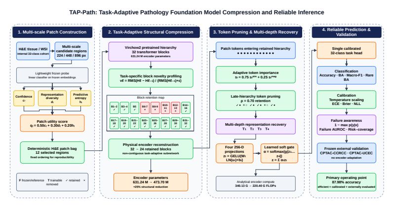
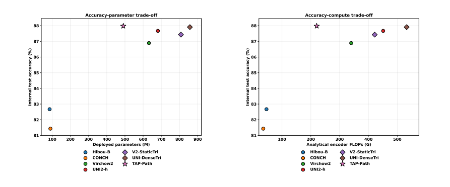
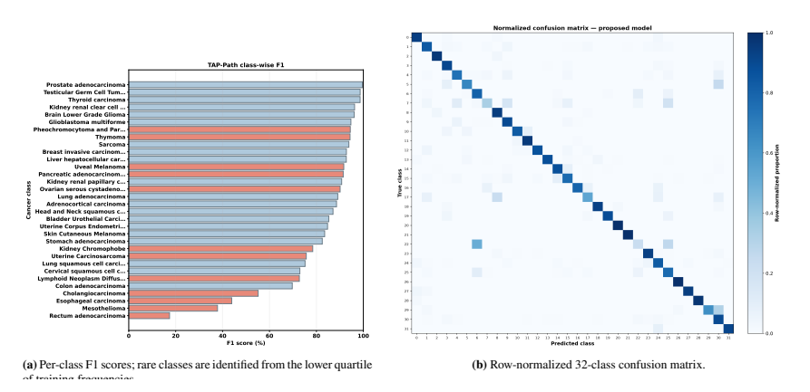

<div align="center">

# TAP-Path
### Task-Adaptive Structural and Token Pruning for Efficient and Reliability-Aware Pathology Foundation Models

**Mehedi Hasan · Ashfak Yeafi · Md Khairul Islam**

[Paper PDF](paper/paper.pdf) · [arXiv](https://arxiv.org/abs/2609.04071) · [Results](#reported-results) · [Code availability](#code-availability)

**24.96% fewer encoder parameters · 35.20% lower analytical encoder FLOPs · 87.98% internal accuracy**

</div>



*Architecture from Figure 3 of the accompanying manuscript.*

## Overview

TAP-Path compresses the pretrained Virchow2 parent encoder directly for a downstream pathology task. It combines validation-constrained, non-contiguous transformer-block selection with input-adaptive token pruning and a lightweight multi-depth gated task head. The objective is to reduce the deployed encoder footprint while examining discrimination, calibration, failure detection, and transfer together.

**Research status:** preprint / manuscript under review. The linked arXiv version and the accompanying manuscript may differ in wording and experimental detail; the local [paper PDF](paper/paper.pdf) is the source for the tables below. This repository currently contains the paper, figures, and research documentation.

## Method

1. **Construct image-level patch bags.** Select 12 regions per image from multiple source crop scales. A training-only patch probe supports a deterministic selection manifest that balances confidence, diversity, and entropy.
2. **Select and remove blocks.** Screen task-adaptive, non-contiguous block configurations using development data, then physically remove unselected blocks rather than leaving inactive parameters resident.
3. **Prune patch tokens.** Apply input-adaptive token selection in the late hierarchy. The locked model retains **24 of 32 blocks** and **70% of patch tokens after the pruning point**.
4. **Recover complementary features.** Combine four retained-depth representations through a gated task head.
5. **Evaluate reliability.** Use validation-only temperature scaling, proper scoring rules, failure detection, selective prediction, rare-class analysis, and bootstrap uncertainty.

## Evaluation protocol

| Partition | Images / WSIs | Scope |
| --- | ---: | --- |
| Internal training | 17,769 images | 32 classes |
| Internal validation | 3,867 images | 32 classes |
| Locked internal test | 3,859 images | 32 classes |
| CPTAC-CCRCC transfer | 209 WSIs | One represented disease class |
| CPTAC-UCEC transfer | 224 WSIs | One represented disease class |

Architecture selection, task-head optimization, calibration, and threshold development exclude the internal test set and CPTAC cohorts. CPTAC counts refer to WSIs, not verified unique patients. Its two represented classes provide limited cross-cohort evidence rather than 32-class external validation.

## Reported results

All values below are reported in the accompanying manuscript; they have not been independently rerun for this repository. TAP-Path discrimination and reliability values are **mean ± standard deviation over three task-head seeds**.

| Metric | TAP-Path |
| --- | ---: |
| Encoder parameters | 473.70M |
| Total deployed parameters, including task head | 479.40M |
| Encoder parameter reduction vs. parent | 24.96% |
| Analytical encoder FLOPs | 220.40G |
| Analytical FLOP reduction vs. parent | 35.20% |
| Internal test accuracy | 87.98 ± 0.067% |
| Internal balanced accuracy | 81.26 ± 0.49% |
| Internal macro-F1 | 82.38 ± 0.48% |
| ECE | 0.0301 ± 0.0022 |
| Brier score | 0.1800 ± 0.0005 |
| Failure-detection AUROC | 0.9047 ± 0.0060 |

### Same-task encoder comparison

| Model | Internal accuracy (%) | Macro-F1 (%) | Analytical encoder FLOPs (G) |
| --- | ---: | ---: | ---: |
| Hibou-B | 82.67 | 76.33 | 46.32 |
| CONCH | 81.43 | 76.11 | 35.13 |
| Full Virchow2 | 86.89 | 80.94 | 340.13 |
| UNI2-h | 87.67 | 81.75 | 450.97 |
| **TAP-Path** | **87.98 ± 0.067** | **82.38 ± 0.48** | **220.40** |



*Figure 6: accuracy-efficiency trade-offs. The source figure also includes the manuscript's higher-compute fusion comparisons. Encoder FLOPs are analytical estimates, not measured full-slide throughput.*

### Frozen CPTAC transfer

| Cohort | WSIs | Accuracy (%) |
| --- | ---: | ---: |
| CCRCC | 209 | 87.40 ± 0.28 |
| UCEC | 224 | 94.79 ± 1.44 |
| Pooled | 433 | 91.22 ± 0.83 |

Present-class balanced accuracy is **91.10 ± 0.81%**. This is complementary transfer evidence for CCRCC and UCEC; it does not establish superiority across all models or pan-cancer external generalization.

<details>
<summary><strong>Class-level analysis and reproducibility details</strong></summary>



*Figure 9: class-level internal test analysis.*

The primary head uses AdamW, learning rate 7e-4, weight decay 2e-4, batch size 384, a maximum of 130 epochs, and early stopping patience 18. Task-head seeds are 42, 123, and 2026. Calibration is fitted on validation data only. A separate rare-aware operating analysis changes the head objective after the encoder is locked; it must not be conflated with the primary result.

</details>

## Scope and limitations

- The final deployed model remains large; the study improves efficiency within the high-capacity pathology-model regime.
- Analytical FLOP savings do not directly establish equivalent wall-clock, energy, or end-to-end WSI throughput gains.
- The reported baseline differences are observed comparisons; the manuscript does not provide paired baseline prediction files for a paired significance test.
- Retrospective reliability evaluation does not establish clinical decision utility or prospective deployment performance.

## Code availability

**Code will be available upon acceptance of the paper.** Source code, model weights, and execution commands are not included in this documentation release.

## Citation

```bibtex
@misc{hasan2026tappath,
  title={TAP-Path: Task-Adaptive Structural and Token Pruning for Efficient and Trustworthy Pathology Foundation Models},
  author={Hasan, Mehedi and Yeafi, Ashfak and Islam, Md Khairul},
  year={2026},
  eprint={2609.04071},
  archivePrefix={arXiv},
  primaryClass={cs.CV},
  url={https://arxiv.org/abs/2609.04071}
}
```

The citation follows the public arXiv title. Figure provenance is recorded in [assets/README.md](assets/README.md). TCGA, CPTAC, and pretrained model access remain subject to their original providers' terms.

[Research profile](https://github.com/mhasan96) · [Website](https://sites.google.com/view/i-am-mehedi) · [Contact](mailto:hasanme1@msu.edu)
